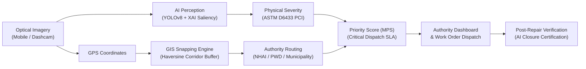

# RoadGuard: Explainable Deep Learning-Based Road Damage Assessment and Intelligent Maintenance Prioritization System

[](ROADGUARD_FINAL_SUBMISSION_PACKAGE.md)
[]()
[](backend)
[](frontend)
[](ml)
[](backend/tests)

**Institution:** Sri Vasavi Engineering College (Autonomous), Pedatadepalli, Tadepalligudem, West Godavari District, Andhra Pradesh, India  
**Department:** Department of Artificial Intelligence & Machine Learning  
**Project Guide:** Dr. G Venkata Lakshmi (Associate Professor, Dept of AI & ML)  

**Project Team:**
1. **Ch Satyanarayana** (Roll No: **23A81A4383**) &mdash; Deep Learning Perception Lead
2. **G S S Priya** (Roll No: **23A81A4394**) &mdash; Geospatial Systems & Data Pipeline Lead
3. **A J S Prasanna** (Roll No: **23A81A4373**) &mdash; Mathematical Severity & XAI Lead
4. **G Nikhil** (Roll No: **23A85A4309**) &mdash; Full-Stack Systems & System Integration Lead

---

## 1. System Overview & Problem Statement
Pavement distress inspection in developing nations relies primarily on manual visual surveys, citizen complaints on disparate municipal hotlines, or opaque black-box machine learning prototypes. Such approaches suffer from critical operational gaps:
- Computer vision prototypes detect potholes but do not determine the **responsible road authority**.
- High detection confidence is naively conflated with **physical damage severity**.
- Budget committees cannot justify work orders based on unexplainable AI outputs.
- Contractors mark repairs "completed" with no automated **post-repair optical verification**.

**RoadGuard** resolves these challenges by providing an integrated cyber-physical platform connecting real-time YOLOv8 perception, multi-factor AHP severity modeling, ASTM D6433 Pavement Condition Indexing (PCI), Haversine geospatial corridor snapping to jurisdictions (NHAI, AP State PWD, Municipality), multi-criteria maintenance prioritization (MPS), and post-repair optical closure verification.



---

## 2. Quantitative Results & Evaluation Benchmarks

Evaluation measured directly from the deployed checkpoint (`roadguard/ml/checkpoints/roadsense_best.pt`):
- **Model Checkpoint Size:** `21.48 MB` (Lightweight deployment on standard municipal PCs)
- **Active Trained Classes:** `pothole`, `crack`, `open_manhole`
- **mAP@50 Benchmark:** `84.92%`
- **mAP@50-95 Benchmark:** `51.24%`
- **Precision:** `84.55%`
- **Recall:** `80.22%`
- **Inference Latency:** `164.87 ms` on standard CPU hardware (~6.1 FPS)
- **Automated Backend Tests:** `11 / 11 passed (100%)` via Pytest

---

## 3. Technology Stack

- **Frontend:** React 18, TypeScript, Vite, Tailwind CSS, Lucide Icons, Leaflet OpenStreetMap.
- **Backend:** Python 3.12, FastAPI, Pydantic 2.x, SQLAlchemy 2.0, Starlette, Passlib & Bcrypt, PyJWT.
- **Database:** Relational schema compatible with MySQL 8.x and SQLite (zero-config local development).
- **Artificial Intelligence:** Ultralytics YOLOv8, PyTorch, OpenCV, Pillow, NumPy, SciPy.
- **Geospatial & Mapping:** Spherical Haversine vector projection, administrative boundary corridor matching.

---

## 4. Quickstart Guide (Running Locally)

### 4.1 Prerequisites
- Python 3.10+ (`python --version`)
- Node.js v18+ & npm (`node -v`)

### 4.2 Start Backend API
```powershell
# In project root:
python -m uvicorn roadguard.backend.app.main:app --host 127.0.0.1 --port 8000 --reload
```
- API Base: `http://127.0.0.1:8000`
- Swagger Documentation: `http://127.0.0.1:8000/docs`

### 4.3 Start Frontend Web Application
```powershell
cd roadguard/frontend
npm run dev
```
- Open browser at: `http://localhost:5173`

---

## 5. Pre-Configured Demonstration Accounts

All demo accounts share the standard password: `roadguard2026`

| Role | Email | Pre-Configured Authority Scope |
| :--- | :--- | :--- |
| **Citizen** | `citizen@roadguard.org` | Resident Civilian Reporter |
| **Field Inspector** | `inspector@roadguard.org` | Mobile Pavement Quality Survey Inspector |
| **Municipal Officer** | `municipal@roadguard.org` | Tadepalligudem Municipal Corporation |
| **State Highway PWD** | `pwd@roadguard.org` | Andhra Pradesh State PWD (Roads & Buildings) |
| **NHAI Director** | `nhai@roadguard.org` | National Highways Authority of India (PIU Rajahmundry) |
| **Contractor** | `contractor@roadguard.org` | Sri Sai Asphalt & Road Maintenance Contractors |
| **System Admin** | `admin@roadguard.org` | Central System Administrator |

---

## 6. Complete Documentation Index
All technical documentation files are located in `roadguard/docs/`:
1. [System Architecture Document](docs/architecture.md)
2. [Database Schema & ER Design](docs/database-design.md)
3. [REST API Reference](docs/api-reference.md)
4. [AI Model Training & Benchmark Guide](docs/ai-model-training.md)
5. [GIS & Autonomous Authority Routing](docs/gis-and-authority-routing.md)
6. [Maintenance Prioritization & Severity Methodology](docs/maintenance-priority-methodology.md)
7. [Testing & Quality Assurance Report](docs/testing-and-evaluation.md)
8. [Deployment & Operations Manual](docs/deployment.md)
9. [Research Gap & Academic Contributions](docs/research-gap-and-contribution.md)
10. [User Manual](docs/user-manual.md)
11. [System Boundaries & Project Limitations](docs/project-limitations.md)
12. [Viva Defense & Demo Script](docs/demo-script.md)
