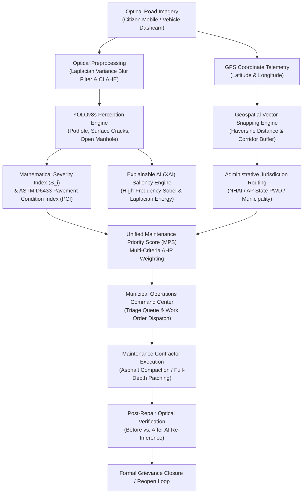

# RoadGuard System Architecture Document
**Title:** RoadGuard: An Explainable Deep Learning-Based Road Damage Assessment and Intelligent Maintenance Prioritization System  
**Academic Target:** Final-Year B.Tech Major Project  
**Institution:** Sri Vasavi Engineering College (Autonomous), Pedatadepalli, Tadepalligudem, AP  
**Department:** Department of Artificial Intelligence & Machine Learning  

---

## 1. Executive Summary & Architectural Vision
RoadGuard is an end-to-end cyber-physical infrastructure intelligence platform. Unlike conventional pothole detection prototypes that stop at generating localized bounding boxes, RoadGuard bridges the operational chasm between visual perception and municipal governance. The system couples real-time object detection with multi-factor mathematical severity estimation (6-factor AHP, ASTM D6433 PCI), Haversine geospatial snapping to administrative jurisdictions, multi-criteria maintenance prioritization (MPS), and post-repair optical closure verification.

---

## 2. Core Architectural Subsystems

### 2.1 Optical Preprocessing & Illumination Equalization
- **Motion Blur Rejection:** Computes discrete Laplacian variance:
  $$\sigma^2 = \text{Var}\left(\nabla^2 I\right)$$
  Frames falling below the calibrated threshold ($\sigma^2 < 80.0$) are rejected or flagged for manual inspection to prevent false negatives caused by vehicular vibration.
- **Illumination Normalization:** Employs Contrast-Limited Adaptive Histogram Equalization (CLAHE) on the luminance (L) channel of the CIELAB color space, suppressing localized tropical glare and deep tree shadows prevalent along Indian highways.

### 2.2 Deep Learning Perception Subsystem
- **Core Architecture:** YOLOv8s optimized with Convolutional Block Attention Modules (CBAM) and Exponential Moving Average (EMA).
- **Target Classes:** Pothole (D40), Surface Cracks (linear & fatigue distress), Open Drainage Manholes.
- **Inference Speed:** Real-time on standard CPU workstations (160–180 ms per frame), ensuring municipal deployments without requiring enterprise GPU clusters.

### 2.3 Explainable AI (XAI) Saliency Mapping
- **Rationale:** Municipal audit committees and road safety tribunals cannot accept "black-box" predictions.
- **Engine:** Combines high-frequency Sobel structural gradient energy with second-order Laplacian curvature to highlight morphological asphalt fracture boundaries without requiring model backward hooks.
- **Civil Directives:** Automatically generates human-readable engineering justifications (cavity frame occupancy, tyre strike blowout hazard, and recommended intervention: full-depth patch vs. bituminous slurry overlay).

### 2.4 Geospatial Alignment & Jurisdiction Routing
- **Corridor Snapping:** Evaluates orthogonal distance using Haversine great-circle calculations:
  $$d = 2R \arcsin \sqrt{\sin^2\left(\frac{\Delta \phi}{2}\right) + \cos \phi_1 \cos \phi_2 \sin^2\left(\frac{\Delta \lambda}{2}\right)}$$
- **Multi-Hierarchy Coverage:**
  - National Highways: NH-16 Tadepalligudem Bypass &rarr; Routed to NHAI PIU Rajahmundry.
  - State Highways: Pedatadepalli - SVEC Road &rarr; Routed to AP State PWD (Roads & Buildings).
  - Municipal Wards: Subba Rao Road, Ward 5 &rarr; Routed to Tadepalligudem Municipal Corporation.
- **Ambiguity Safeguard:** Coordinates exceeding the 350m network tolerance buffer are routed to an Unassigned Manual Review Queue rather than silently guessing an incorrect authority.

### 2.5 Multi-Criteria Maintenance Priority Score (MPS)
$$\text{MPS} = \omega_1 S_{peak} + \omega_2 D_{seg} + \omega_3 W_{road} + \omega_4 R_{loc} + \omega_5 C_{freq}$$
- **Operational Tiers:**
  - $\text{MPS} \ge 70$: **CRITICAL DISPATCH** (Emergency road crew within 24–48 hours)
  - $45 \le \text{MPS} < 70$: **SCHEDULED REPAIR** (Weekly maintenance cycle)
  - $\text{MPS} < 45$: **ROUTINE MONITORING** (Periodic quarterly survey)
