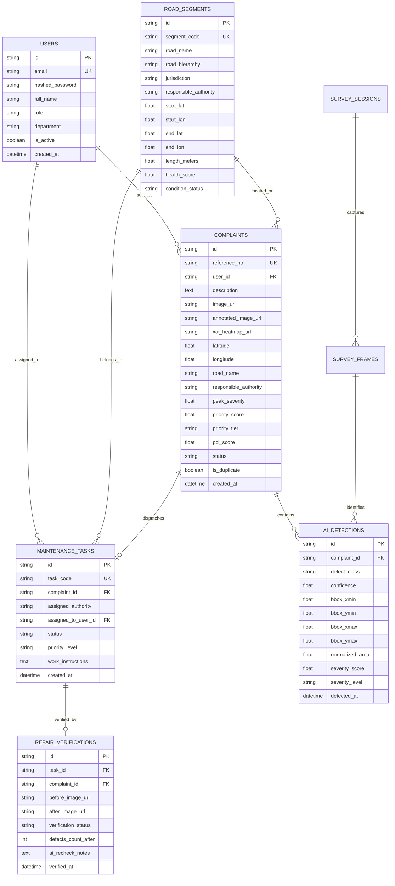

# RoadGuard Relational Database Design
**Engine Compatibility:** MySQL 8.x (Enterprise/Production) & SQLite 3.x (Zero-Configuration Local Development)  
**ORM:** SQLAlchemy 2.0 with Declarative Base & Session Pooling  

---

## 1. Entity-Relationship (ER) Overview

---

## 2. Table Specifications & Indexes

### 2.1 `users`
- Stores authentication credentials with `bcrypt` 12-round salt.
- Role-based permissions: `citizen`, `field_inspector`, `local_authority`, `municipal_authority`, `state_highway_authority`, `nhai_authority`, `maintenance_contractor`, `admin`.
- Index: `idx_users_email` (Unique).

### 2.2 `road_segments`
- Defines surveyed physical road corridors.
- Fields: `segment_code`, `road_name`, `road_hierarchy`, `jurisdiction`, `responsible_authority`, `start_lat`, `start_lon`, `end_lat`, `end_lon`, `health_score` (PCI index [0-100]).

### 2.3 `complaints`
- Stores citizen-reported and inspector-logged road distress records.
- Uniquely identified by `reference_no` (`RG-YYMMDD-XXXX`).
- Foreign keys: `user_id` &rarr; `users.id`, `matched_segment_id` &rarr; `road_segments.id`.
- Duplicate tracking: `is_duplicate`, `duplicate_of_id`, `duplicate_count`.

### 2.4 `ai_detections`
- Stores bounding box coordinates $[x_{min}, y_{min}, x_{max}, y_{max}]$ normalized to $[0.0, 1.0]$.
- Physical severity calculation score $S_i$ and categorical severity grade.

### 2.5 `maintenance_tasks`
- Dispatched contractor work orders (`WO-YYMMDD-XXXX`).
- Lifecycle status tracking: `Assigned`, `In Progress`, `Repair Completed`, `Closed`, `Reopened`.

### 2.6 `repair_verifications`
- Post-repair optical comparison record storing before/after imagery, residual defect counts, and inspector certification notes.
